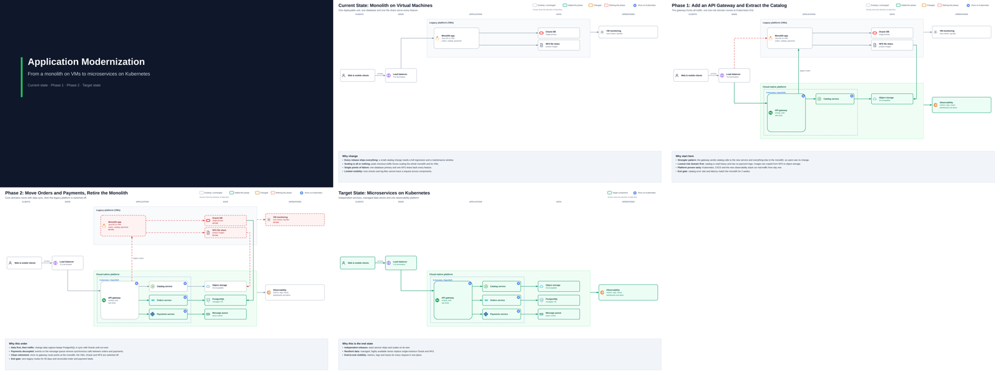

# architecture-diagrams: a Claude skill for presentation-grade architecture diagrams

<p>
  
  
  
</p>

**Created by Vikrant Nalawade** · [LinkedIn](https://www.linkedin.com/in/vikrantnalawade) ·
[GitHub](https://github.com/techwithvikrant)

Turn a screenshot, a whiteboard photo or a plain description into **customer-ready architecture
diagrams**, from current state through migration phases to target state. Every run delivers:

- an editable **draw.io** file (all pages, native connected shapes)
- one **PNG per page** (3840x2160)
- one combined vector **PDF** to present

Diagrams have no crossing arrows, no text on lines, consistent status colours (existing, new,
changed, retiring), brand icons, and a short "why" panel on every slide.



## How it works
- `scripts/drawio_lib.py`: place boxes on a 1920x1080 grid and give every edge explicit, axis-aligned
  waypoints. A **geometry validator** blocks the build on crossings, arrows through boxes,
  overlapping labels or off-canvas items.
- draw.io itself (headless CLI) renders the PNG and PDF, so the output matches what opens in the editor.
- `references/`: layout and routing playbook, clarifying-question bank, migration-story template, API, icons.
- `examples/monolith-to-microservices/`: a complete 5-page deck (monolith on VMs to microservices on
  Kubernetes). Works as a template for any technology.

## Install

Skills belong to your Claude account. Upload the skill once and it is available wherever you use
that account with code execution turned on.

**Before you start (all apps):** turn on **Settings > Capabilities > Code execution and file creation**
(called "Create and edit files" in newer layouts). On Team and Enterprise plans, an org owner must
first enable Skills in **Organization settings**.

### Claude.ai in any browser (Chrome, Edge, Safari, Firefox)
1. Download `architecture-diagrams.zip` from the [Releases page](https://github.com/techwithvikrant/architecture-diagrams/releases/latest). Or zip this folder yourself; the
   folder must stay named `architecture-diagrams`.
2. Open claude.ai, then go to **Customize > Skills > + > Create skill > Upload a skill**.
3. Select the zip. Check that the skill appears in the list with its toggle **on**.

### Claude Desktop (Windows / macOS app)
1. Download the zip as above.
2. In the app, open **Customize > Skills > + > Create skill > Upload a skill**. If your version still
   has the older layout, it's **Settings > Capabilities > Skills > Upload skill**.
3. Upload the zip and make sure the toggle is on.

A skill you upload in the browser also appears in the Desktop app, and the other way round, because
both use the same account. Cowork in the Desktop app uses it too.

### Claude in Chrome (browser extension)
The Claude in Chrome extension is a browsing agent: it reads and clicks web pages for you. There is
nothing to install in the extension itself. To make diagrams:

- upload the skill once through claude.ai or Claude Desktop (steps above), then
- ask for diagrams in claude.ai (in a Chrome tab) or in Claude Desktop, where Claude has the code
  environment that renders the draw.io, PNG and PDF files.

Whether the extension's side panel can run skills depends on your plan and extension version.
Check Anthropic's help centre for the latest.

### Claude Code (terminal / IDE)
```bash
git clone https://github.com/techwithvikrant/architecture-diagrams ~/.claude/skills/architecture-diagrams
```
On Windows, the path is `%USERPROFILE%\.claude\skills\architecture-diagrams`. Skills turned on in your
Claude account settings also sync to Claude Code when you're signed in with the same account; run
`/skills` to check.

### Sharing inside your organization (Team / Enterprise)
Go to **Customize > Skills**, open the skill, click **Share**, and choose specific people or the
entire organization. An org owner must first enable skill sharing in Organization settings.

### Troubleshooting
- **Upload fails:** the zip must contain a top-level folder named exactly `architecture-diagrams`,
  with `SKILL.md` inside it.
- **Skill doesn't trigger:** ask explicitly, for example "Use the architecture-diagrams skill to ...".
- **Build says the draw.io CLI is missing or the download failed:** the sandbox needs network access
  to github.com and cdn.jsdelivr.net. On Team or Enterprise plans, ask an org owner to allow these domains.

## Which Claude model to use

| Use | Model |
| --- | --- |
| **Recommended for most work** (multi-page decks, phased migrations, recreating complex screenshots) | **Claude Opus 5.5** |
| Quick, single, simple diagrams | Claude Sonnet 5.5 |

Turn on extended thinking if your app offers it. Layout planning benefits from it.

## Use
It works for any architecture (cloud, data, network, security, application, observability). Just ask, for example:
- "Recreate this diagram cleanly, then show the migration phase by phase and the final state."
- "Use the architecture-diagrams skill: current vs target state for our web platform moving to Kubernetes."
- "Draw a data-flow diagram of this pipeline and give me draw.io, PNG and PDF."

Claude asks up to 3 clarifying questions only if something is ambiguous, then builds, validates,
visually reviews and delivers the files.

## Run the example locally
```bash
bash scripts/setup_drawio.sh          # downloads draw.io CLI to /tmp/drawio-cli (Linux, needs xvfb)
python3 examples/monolith-to-microservices/build.py ./out
```

## Requirements
Linux with `xvfb-run`, Python 3 with Pillow and pypdf, and network access to github.com
(draw.io release) and cdn.jsdelivr.net (Simple Icons).

## Licence and credits
- Skill code and docs: MIT (see `LICENSE`).
- draw.io desktop (jgraph) is Apache-2.0 and is downloaded at runtime, not redistributed.
- Brand icons come from [Simple Icons](https://simpleicons.org) (CC0). Logos are trademarks of their
  respective owners and are used only to identify products.

## Author

**Vikrant Nalawade**
- LinkedIn: https://www.linkedin.com/in/vikrantnalawade
- GitHub: https://github.com/techwithvikrant

If this skill saves you time, please star the repo and share your diagrams. Issues and pull requests are welcome.
